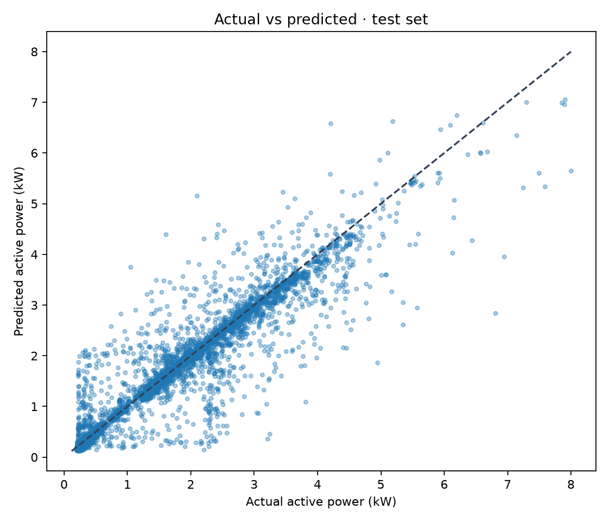
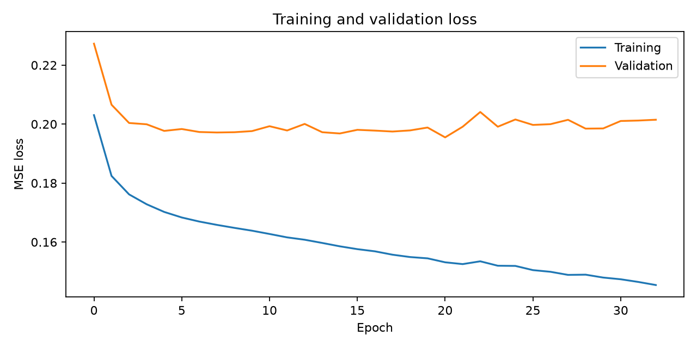
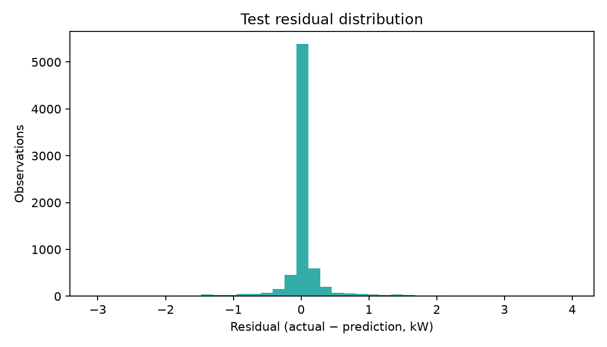
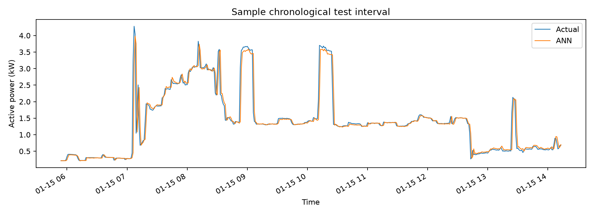

# EnergySense: Household Electricity Consumption Prediction Using an ANN

## Abstract
This study predicts Global_active_power one minute ahead using a dense TensorFlow/Keras MLP and real household electricity readings. It uses a chronological 50,000-row sample (or all valid rows if fewer), time-ordered train/validation/test partitions, and a previous-reading persistence baseline. Dataset facts and evaluation metrics below are computed by the project scripts.

## Introduction and objectives
The task is short-horizon regression on household load. The project demonstrates artificial neurons and activation functions (Unit I), feedforward propagation (Unit II), and loss, gradient descent and backpropagation (Unit III). It produces a reproducible training experiment, an ANN-versus-baseline evaluation, and a dashboard for exploration and predictions.

## Dataset
The supplied semicolon-delimited file has 2,075,259 rows and nine original fields: Date, Time, Global_active_power (kW), Global_reactive_power (kW), Voltage (V), Global_intensity (A), and Sub_metering_1/2/3 (Wh). Missing `?` readings are converted to missing numeric values. There are 2,049,280 complete valid observations after removing invalid timestamps and incomplete measurements. The selected chronological subset has 50,000 rows from 2006-12-16T17:24:00 to 2007-01-20T10:48:00. The selected data file preserves exactly the nine source columns.

### Dataset summary
| Measurement | Mean | Std. dev. | Min | Max |
|---|---:|---:|---:|---:|
| Global_active_power | 1.0916 | 1.0573 | 0.0760 | 11.1220 |
| Global_reactive_power | 0.1237 | 0.1127 | 0.0000 | 1.3900 |
| Voltage | 240.8399 | 3.2400 | 223.2000 | 254.1500 |
| Global_intensity | 4.6278 | 4.4444 | 0.2000 | 48.4000 |
| Sub_metering_1 | 1.1219 | 6.1530 | 0.0000 | 88.0000 |
| Sub_metering_2 | 1.2985 | 5.8220 | 0.0000 | 80.0000 |
| Sub_metering_3 | 6.4584 | 8.4372 | 0.0000 | 31.0000 |

## Preprocessing and prediction horizon
Pandas reads the TXT directly, parses day-first Date and Time, and converts measurement columns to numeric values. Rows with missing values are dropped; no data are imputed or synthesized. The first 50,000 complete rows are kept chronologically. For target at time *t*, inputs are the six non-target electrical readings at *t−1*, Global_active_power at exact times *t−1* and *t−30*, and cyclic hour/weekday features known at *t*. The target horizon is one minute. Rows with missing exact lag timestamps are excluded. The target at *t* is not an input. The feature scaler is fitted on training rows only.

## ANN and learning
The MLP contains 12 inputs, Dense(64, ReLU), Dense(32, ReLU), and one linear output that predicts a residual correction to the previous-minute reading. A residual multiplier is calibrated from validation predictions only; the final estimate is previous active power plus the scaled correction. A dense neuron computes **z = wᵀx + b**. ReLU is **max(0,z)**. Feedforward propagation passes activations through the layers. MSE is **(1/n)Σ(yᵢ−ŷᵢ)²**. Backpropagation applies the chain rule to calculate each weight and bias gradient; Adam updates parameters. Early stopping monitors validation loss and restores the best weights.

## Experimental methodology and results
The split is chronological: 70% training, 15% validation, and 15% test. Training uses Adam, MSE loss, MAE metric, batch size 128, seed 42, and early stopping. The persistence baseline predicts the prior one-minute active-power reading at each test timestamp.

| Model | MAE (kW) | RMSE (kW) | R² |
|---|---:|---:|---:|
| ANN | 0.159626 | 0.371657 | 0.898419 |
| Persistence baseline | 0.140831 | 0.384987 | 0.891002 |

Test predictions: 7,495. ANN lower MAE: **False**. ANN lower RMSE: **True**. These are measured values on the held-out test interval.

The comparison is mixed: the persistence baseline has lower MAE, while the ANN has lower RMSE and higher R². The results do not support claiming that the ANN is better on every metric.

## Diagnostic plots

The scatter plot compares test estimates with observed targets; loss curves show training/validation behavior; residuals show signed errors; and the sample series illustrates the model over a chronological test segment. The baseline metrics determine comparative value; plots alone do not establish performance.

## Limitations, future work, and conclusion
The experiment uses an early chronological segment of a much longer dataset, so results apply to that interval. Exact-time lag matching reduces usable rows where readings are missing. In this test interval, the ANN improves RMSE and R² but does not improve MAE over persistence. Future work can evaluate more temporal cut points, tune regularization, and add transparent baselines. No generalization beyond this experiment is implied.

## References
1. Hebrail, G. and Berard, A. (2006). *Individual Household Electric Power Consumption*. UCI Machine Learning Repository.
2. Goodfellow, I., Bengio, Y. and Courville, A. (2016). *Deep Learning*. MIT Press.
3. Kingma, D. P. and Ba, J. (2015). Adam: A Method for Stochastic Optimization. ICLR.
